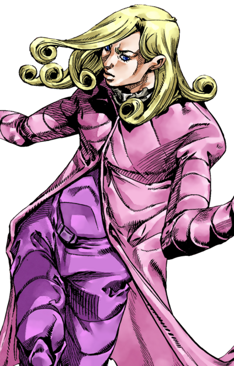
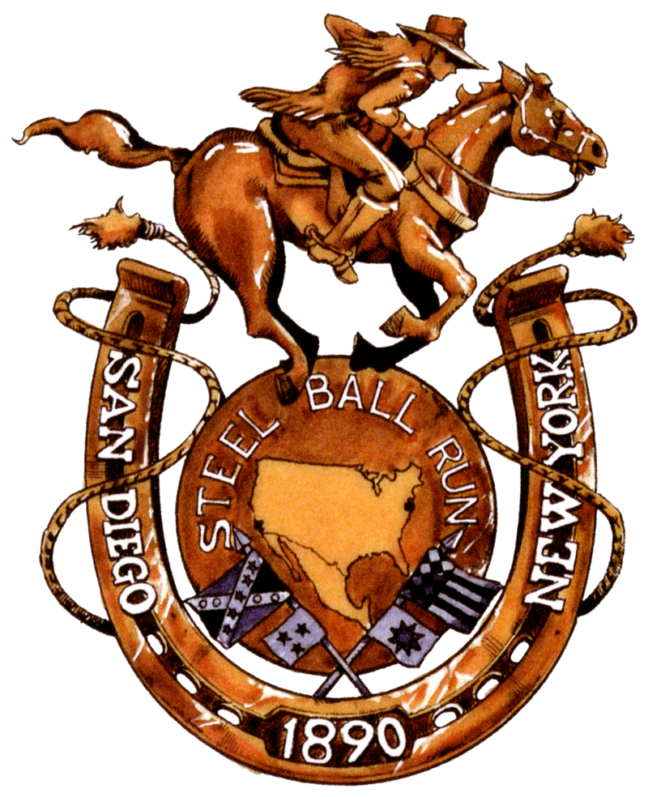
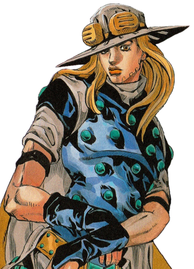
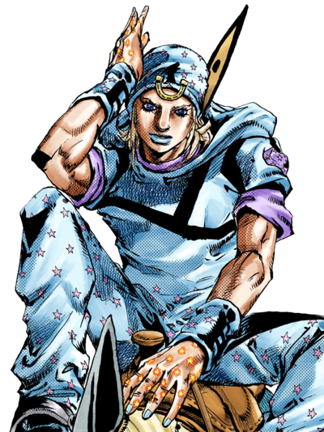

  <!-- SBR Menacing SFX Top -->
  
<samp><b>ゴ ゴ ゴ ゴ ゴ ゴ ゴ ゴ ゴ ゴ ゴ ゴ ゴ ゴ ゴ ゴ ゴ ゴ ゴ ゴ</b></samp>

  <!-- Visual Hero Banner: Valentine | SBR Logo | D4C -->
  <table>
    <tr>
      <td align="center" width="28%" style="border: none;">
         
        <b>Funny Valentine</b> 
        23rd President
      </td>
      <td align="center" width="44%" style="border: none;">
          
         
        
        
      </td>
      <td align="center" width="28%" style="border: none;">
         
        <b>Dirty Deeds Done</b> 
        Dirt Cheap [D4C]
      </td>
    </tr>
  </table>

  <!-- Sound Effect Divider -->
  
<samp><b>ド ド ド ド ド ド ド ド ド ド ド ド ド ド ド ド ド ド ド ド</b></samp>

---

### 🇺🇸 Stand Master & Engineering Arsenal

| Primary Universe (Core Mastery) | Parallel Universes (Actively Expanding) |
|:---:|:---:|
|            |          |

---

### 🫀 Featured Artifacts (Projects)

<table>
  <tr>
    <td width="33%" align="center">
      <h3>🌸 Lume Salon</h3>
      
<b>Public Project</b>

      
Modern luxury SPA web application built with silky responsive animations and booking workflow.

      

        
        
        
      

      
<a href="https://github.com/infoburmalmind-cyber/lume-salon"><b>👉 View Repository</b></a>

    </td>
    <td width="33%" align="center">
      <h3>🌌 OmniDrive</h3>
      
<b>Private Project</b>

      
Cross-platform cloud workspace (Android & Windows) with semantic vector search, RU/KY localization, and AI tools.

      

        
        
        
      

      
Protected Stand Relic

    </td>
    <td width="33%" align="center">
      <h3>🛡️ KeyFlowMacro</h3>
      
<b>Private Project</b>

      
Desktop automation and keystroke engine with stealth execution, global hotkeys, and cryptographically verified licenses.

      

        
        
        
      

      
Protected Stand Relic

    </td>
  </tr>
</table>

---

### 🌀 The Golden Spin Competitors

  <table>
    <tr>
      <td align="center" width="30%" style="border: none;">
         
        <b>Gyro Zeppeli</b> 
        <i>"Lesson 5: The detour was our shortest path."</i>
      </td>
      <td align="center" width="40%" style="border: none;">
         
        <b>The Golden Rectangle (φ = 1.618)</b> 
        Infinite Spin • High Performance • Pixel Precision
      </td>
      <td align="center" width="30%" style="border: none;">
         
        <b>Johnny Joestar</b> 
        <i>Tusk ACT 1-4 • Relentless Evolution</i>
      </td>
    </tr>
  </table>

---

### 📊 Love Train Transmission (GitHub Activity)

  
    
  
    
  

---

  
<i>"My heart and actions are utterly unclouded... They are all those of 'Justice'."</i>

  

    
  

  
<samp><b>ど じゃ あ あ ～～ ん (DOJYAAAN)</b></samp>

  

