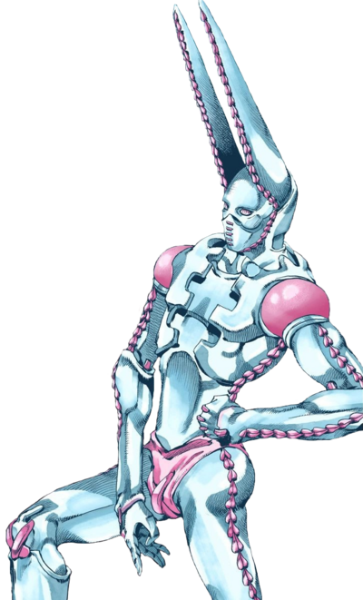
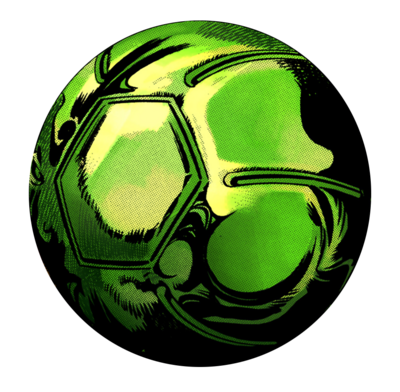

  <!-- Visual Hero Banner: Valentine | SBR Logo | D4C -->
  <table>
    <tr>
      <td align="center" width="20%" style="border: none;">
        
      </td>
      <td align="center" width="60%" style="border: none;">
          
         
        
        
        
        
      </td>
      <td align="center" width="20%" style="border: none;">
        
      </td>
    </tr>
  </table>

  <!-- Quick Info Bar -->
  

    <code>📍 Central Asia (UTC+6)</code> &nbsp;•&nbsp;
    <code>⚡ React 19 • TypeScript • Tailwind</code> &nbsp;•&nbsp;
    <code>🚀 Cross-Platform (Flutter / Dart)</code>
  

---

###  Tech Stack & Capabilities

| Core Frontend (Production Ready) | Cross-Platform & Systems (Active Development) |
|:---:|:---:|
|            |          |

---

###  Featured Projects

<table>
  <tr>
    <td width="33%" align="center">
      <h3>🌸 Lume Salon</h3>
      

      
Luxury beauty salon single-page app featuring interactive appointment booking, dynamic service catalog, and silky Framer Motion animations.

      

        
        
        
      

      
<a href="https://github.com/infoburmalmind-cyber/lume-salon"><b>👉 Open Repository</b></a>

    </td>
    <td width="33%" align="center">
      <h3>🌌 OmniDrive</h3>
      

      
Cross-platform cloud workspace (Android & Windows) with semantic vector search, multilingual UI (RU/KY), and AI Studio integration.

      

        
        
        
      

      
Private Client

    </td>
    <td width="33%" align="center">
      <h3>🛡️ KeyFlowMacro</h3>
      

      
Hardware-level desktop automation client with stealth keystroke engine, global hotkeys, and cryptographically verified JWT licenses.

      

        
        
        
      

      
Private Client

    </td>
  </tr>
</table>

---

###  Engineering Principles & Workflow

  
<b>🔍 Click to expand Architecture & Code Standards</b>

   

  - **Modular Architecture**: Feature-sliced structure, separation of UI, business logic, and API clients for zero-friction maintainability.
  - **Strict Type Safety**: Strict TypeScript compiler rules, typed API responses, and comprehensive runtime validation.
  - **Golden Ratio ($\phi = 1.618$) in UI**: Harmonic typographic scales, balanced whitespace, and 60 FPS hardware-accelerated animations.
  - **Performance First**: Sub-second bundle load via Vite, asset optimization, and minimal re-render cycles.

---

###  GitHub Activity & Statistics

  <table>
    <tr>
      <td align="center" style="border: none;">
        
      </td>
      <td align="center" style="border: none;">
        
      </td>
    </tr>
  </table>

  

---

  

    
  

  

